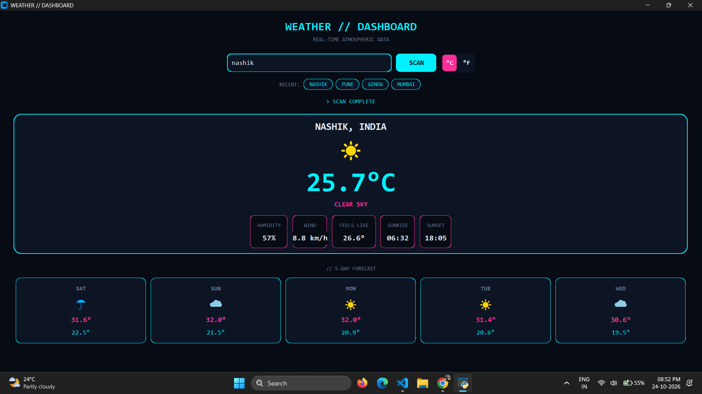

# Weather Dashboard

A futuristic dark-themed desktop weather app built with Python and CustomTkinter. Search any city to see current conditions and a 5-day forecast.

 

## Features
- Futuristic dark neon interface (CustomTkinter)
- Search weather by city name
- Current temperature, humidity, wind, "feels like", sunrise and sunset
- 5-day forecast
- Instant °C / °F switch
- Recent searches saved between sessions
- Animated scanning effect while loading
- Friendly error messages (city not found, no internet)

## How to run
1. Install Python 3.8 or newer
2. Install the dependencies: `python -m pip install -r requirements.txt`
3. Run the app: `python weather.py`

## Data source
Weather data from [Open-Meteo](https://open-meteo.com/) (free, no API key needed).

## Author
Abhishek Paul
